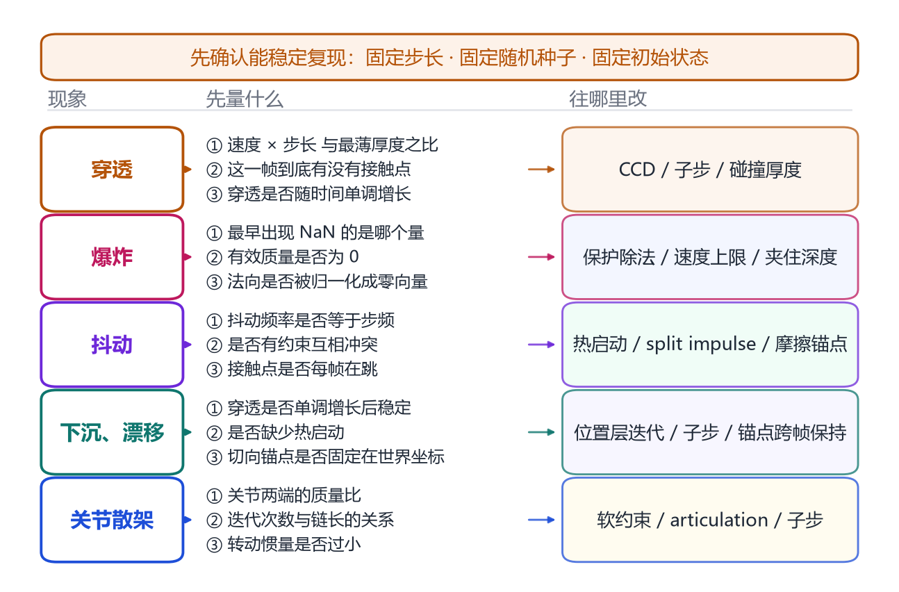
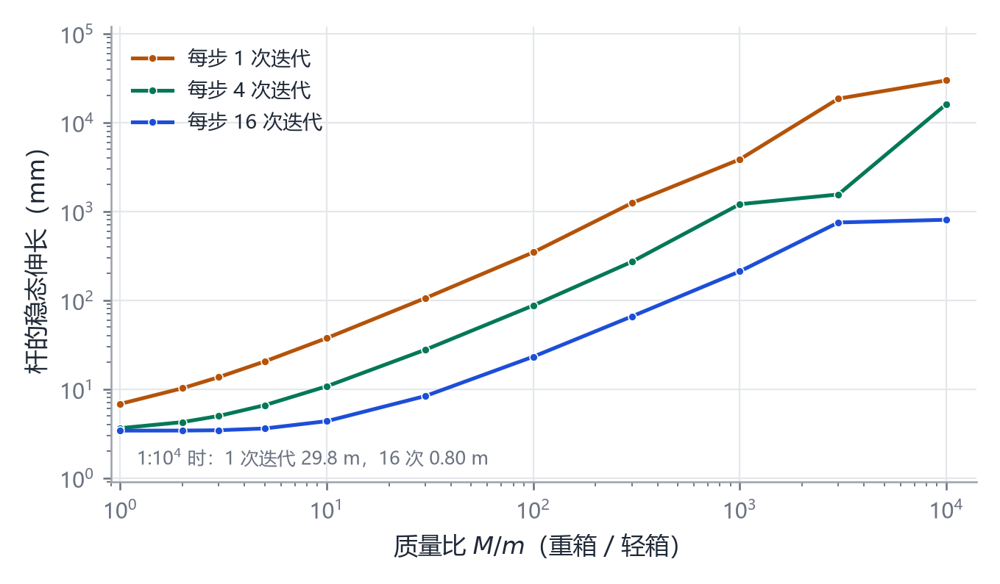

# 第 12 章 刚体模拟的失败模式

上线前两周，缺陷列表里有一半是物理。角色走到楼梯边缘会掉进地板；墙角那摞箱子有时候自己往上一跳；布娃娃被拖到墙边，一条手臂拉成了橡皮筋；切场景回来，摆好的一排瓶子整体挪了两厘米。这些缺陷有一个共同点：引擎没崩，参数没变，代码也没改，只是某个条件被越过了。

按报错去查是查不到的。物理引擎出错的方式不是抛异常，而是输出一个“看起来还在动、但物理上不可能”的状态。要做的是从现象反推是哪一步算错了。这一章把常见故障分成五类，每类给出成因、判别特征和改动方向，最后给一张对照表。图 12-1 是这套分法的路线图：左边是看到的现象，中间是必须先量出来的三个数，右边是对应的改动方向。

<figure class="fig">

<figcaption><b>图 12-1</b>　从现象到成因的判别路径（示意图）。左侧是屏幕上看到的样子，中间是要量的三个量，右侧是对应的改法。箭头只表示“先查这条”，不是唯一原因：抖动和穿透常常同时出现，先分清主次再动手。</figcaption>
</figure>

## 12.1 穿透

穿透是最好认也最难断根的一类。物体的一部分进入了另一个物体内部，视觉上是一角陷进去、整个人掉下去、或者箱子叠到一半相互嵌套。

第一种原因是单步位移过大。物体在一帧里走过的距离超过了另一边的厚度，两个采样时刻都在外面，检测自然什么都没看到。判别方法很简单：把物体的速度乘上步长，与最薄的那一维厚度比一比。一个以 30 m/s 飞行的子弹，在 $1/60$ 秒里走 0.5 米，撞 5 厘米厚的墙必然穿过去。这时候加迭代没有用，得开连续碰撞检测，或者把步长切小，或者给薄物体加一层碰撞厚度。三个办法各有代价：CCD 要给每个快物体做扫掠与求根，子步会成倍增加所有物体的开销，加厚会让物体之间出现看不见的缝隙，角色站在墙边会浮空一厘米。

第二种原因是迭代不足。物体速度不高，但被重物压着，每帧都被压进去一点，位置修正跟不上，穿透稳定在一个深度上不再增长。判别特征是穿透随时间单调增加然后稳定，与速度无关，与压力有关。这类穿透要改的是迭代次数、位置层求解或者步长，而不是 CCD。

第三种原因是这一对物体根本没被检测。图层掩码配错、关节相连的物体默认不互碰、凸分解时漏了一块、三角形网格的 BVH 里有个退化三角形让射线穿透，都会表现为“某些角度能穿过，某些角度不能”。判别方法是把接触对打印出来，看穿过去的那一帧到底有没有生成接触点。没有接触点，问题在宽相或窄相；有接触点但深度为零，问题在流形生成。

第四种原因是尺度。整个场景用米做单位，物体从 0.1 米到 100 米都有，浮点精度在远端坐标上只剩几毫米，碰撞容差却按 0.001 米写死，于是小物体之间永远差一点、大物体之间的接触深度算不准。这类问题在把场景搬到离原点很远的地方时会突然出现，判别特征是所有物体一起出问题，且穿透量恰好等于浮点在这个坐标量级上的分辨率。

第五种是瞬移。直接把物体位置设到别处、用动画驱动一个碰撞体、把物体从池子里取出来重新摆放，如果没有同步更新包围盒和接触缓存，宽相里还留着旧的候选对和旧的位置，这一帧的接触就是错的。

## 12.2 爆炸

爆炸的表现是物体在几帧之内飞出屏幕，或者位置变成 NaN，之后整个场景安静下来——所有坐标都是 NaN，画不出来，也检测不到碰撞。

NaN 的来源可以列举完，实际项目里九成以上落在前三条。

第一条是除零。约束求解要除以有效质量 $k=\mathbf{J}\mathbf{M}^{-1}\mathbf{J}^{\top}$，$\mathbf{J}$ 是约束雅可比，$\mathbf{M}$ 是质量矩阵。两个静态物体之间如果生成了接触，两者的逆质量都是零，$k=0$，冲量变成无穷大或 NaN。静态物体本来不该互碰，但图层配错、地形被当成运动学物体、一个物体被临时设成静态却没清理接触，都会让这种情况发生。

第二条是零向量归一化。碰撞法向由两个面的叉积、或者 GJK 的单纯形算出，两条边平行、三点共线、两个顶点重合时结果是零向量，归一化得到 $0/0$。三角形的退化在美术资产里非常常见：导出的网格里有一片面积为零的薄片，平时不参与碰撞，一旦有物体擦过就触发。

第三条是惯性张量奇异。一个零厚度的平面、一根半径为零的杆，绕某个轴的转动惯量为零，角速度更新时角加速度无穷大。物理上不存在零厚度的物体，数值上却经常被做出来：为了省事用一个 box 模拟地面，高度设成 0.001；或者从建模软件导入的模型包围盒在某一维上退化了。

其余几条不那么常见但同样致命：四元数长时间不归一化，模长漂到零附近，反解出姿态时出现除零；恢复系数被外部配置成 1.2，碰撞后能量增加，下一帧速度更大，正反馈；接触深度在某一帧被算成负几十米（法向搞反了），Baumgarte 项把这个深度换算成一个巨大的修正速度，物体被弹飞。

NaN 的传播速度快得惊人。一个物体的位置变成 NaN，它的包围盒也是 NaN，宽相树的节点更新之后整棵子树的包围盒都变成 NaN，所有和它比较的物体都被判为“可能相交”，窄相开始对每一对做 GJK，得到的全是 NaN 接触，再把 NaN 冲量分给邻居。两三帧之内，一个岛就全灭了。所以定位的时候不能看“第一个 NaN 出现在哪里”，要看“最早出现 NaN 的那个量是什么”——通常它比最终爆炸早好几帧。

工程上的防御比定位更值钱。每个物理步结束时断言所有状态有限，一旦出现就打印物体编号、速度、接触列表，然后停住；速度与角速度加硬上限，超过就截断，这一条能挡住大多数正反馈；接触深度在进入求解器之前夹到 $[-d_{\max},0]$；恢复系数夹到 $[0,1]$；所有除法在分母上加一个与尺度相关的小量，或者干脆用带保护的伪逆。

## 12.3 抖动

抖动是物体在静止状态下持续小幅振动，幅度从零点几毫米到几厘米，频率往往等于物理步频或者它的整数分之一。它不影响正确性，但极其显眼——一摞箱子在画面里嗡。

第一类成因是约束冲突。一个物体同时被关节拉着、被地面托着、被旁边的箱子挤着，三组约束在速度层各自要求不同的速度，顺序冲量逐行让步，最后停在某个折中值上；下一步从零重新来过，又停在另一个折中值上，于是位置在两个值之间来回。判别特征是幅度小、方向固定、每一帧都换向。修法不是加迭代，而是让这几组约束的求解顺序稳定，或者给冲突的一方加软约束。

第二类成因是位置修正过大。Baumgarte 项把穿透换算成修正速度，$\beta$ 取 0.2 时，一次修正能修掉 20% 的穿透；如果 $\beta$ 取到 0.8，物体被推出去的速度很大，下一步又因为重力压回来，形成“弹出—压回”的循环，频率正好是步频。这也是为什么多数引擎把位置修正放到单独的迭代里（split impulse），不让它污染速度。

第三类成因是摩擦不足。物体斜靠在别的物体上，静摩擦刚好不够，每帧滑一点点又弹回来。判别方法是把摩擦系数调大试试，如果抖动消失，问题就在摩擦模型上：可能是静摩擦与动摩擦用了同一个系数、摩擦锥被线性化成了四个方向、或者摩擦锚点在动。

第四类成因是接触流形不稳定。两个盒子面面接触，本应生成四个接触点；如果每帧的接触点在不同的角上跳，法向和力臂都在变，冲量方向跟着翻转。这多发生在流形裁剪的容差不合适、或者接触缓存的匹配用位置而不是特征 ID 的时候。

第五类成因是迭代残余在堆叠里来回。一个十层的塔，底层的误差往上传播，顶层的误差往下压，迭代次数不够时这个来回不会衰减，表现为低频的“呼吸”，周期是几步到十几步。这种抖动幅度最小，但最难消，只能靠子步、热启动和更好的求解顺序。

区分这五类有个简单的办法：记录某个物体的位置随时间的曲线，做一次频谱。峰值落在步频上，问题在求解器或位置修正；落在更低频，问题在约束耦合；只在特定接触对上出现，问题在流形。抖动的修法几乎都不是“把参数调小”，而是“让每一步的初始条件更接近上一步的解”，也就是热启动。

## 12.4 下沉与漂移

下沉是物体慢慢陷进支撑面，漂移是物体在支撑面上慢慢平移或旋转。两者都慢，慢到测试时容易被忽略，等到玩家在场景里转一圈回来，发现摆件全歪了。

下沉最常见的原因是稳态穿透。Baumgarte 项只能把穿透修到“修正速度与重力冲量平衡”的水平：重物压着，每步下沉 $g\Delta t^2$，位置修正只能回收其中一部分，剩下的就沉淀成可见的穿透。物体越重、步长越大、迭代越少，沉淀越深。判别方法：把重力方向反过来或者把物体质量调小，如果穿透明显减小，就是这一类。

第二个原因是缺少热启动。没有热启动时，每帧的支撑冲量都从零开始，迭代有限的情况下，头几次迭代只能把速度压到接近零，物体在这几帧里持续下沉，等冲量建立起来才停住。堆叠越高，这个“建力”过程越长。

第三个原因是休眠把错误冻住了。物体在还有微小穿透的时候睡着，之后位置不再修正，穿透就永久留在那里。玩家再碰它一下，它醒了，穿透被修掉，物体“跳”一下——这就是很多人见过的“碰一下箱子，箱子往上一蹿”。

第四个原因是质量比。轻物体支撑重物体时，顺序冲量的收敛速度取决于有效质量差异，比值越大收敛越慢，稳态误差越大。图 12-2 给出的就是这个效应的量级：一个轻箱用杆吊在天花板上，重箱压在它上面，同样的迭代次数下，质量比从 1 涨到一万，杆的伸长从几毫米涨到近一米。

<figure class="fig">

<figcaption><b>图 12-2</b>　质量比对关节误差的影响（真实一维计算）。场景是“天花板—杆—轻箱—接触—重箱”的竖直一维链：杆长 1 m、双边约束，接触为单边，两箱各高 1 m，轻箱质量 1 kg，重箱质量为横轴上的比值；步长 $1/120$ 秒、Baumgarte 系数 0.2、重力 9.81 m/s²、不加热启动，跑 3 秒后取最后 0.6 秒的平均值。纵轴是杆的伸长量（毫米），双对数坐标。三条线分别是每步迭代 1、4、16 次：迭代越多曲线越低，到 1:10⁴ 时分别是 29.8 m、16.1 m、0.80 m，差了将近两个数量级；但三条线在高比值端都抬了起来，16 次那条最后几乎持平，那时杆已经伸长到 0.8 米，早已不在能用的范围里。这说明“误差随质量比增长”靠加迭代只能把曲线整体压低，压不平。</figcaption>
</figure>

漂移的成因和下沉不同，它多半出在切向。摩擦锚点没有固定在世界坐标上，每帧重新算接触点，锚点跟着接触面滑动，静摩擦就变成了“每帧重新抓住一次”，物体以极慢的速度滑走。斜坡上的静摩擦模型如果只在速度层生效、位置层没有对应约束，物体会缓慢下滑并在坡底堆积。还有一类是位置修正带切向分量：修正方向没有严格沿法向，每修一次就把物体横推一点。

修下沉的方向是提高位置层的求解质量：split impulse 把位置修正独立迭代，热启动让冲量跨帧继承，子步让每步的重力冲量变小。修漂移的方向是让切向约束跨帧连续：摩擦锚点存世界坐标并跟着物体变换，接触流形的特征 ID 保持稳定，位置修正严格投影到法向。

## 12.5 关节散架

关节散架的表现是两块本该连在一起的物体之间出现可见缝隙，或者连接处被拉长、扭断，布娃娃的手臂拉成面条是最典型的画面。

第一个原因是求解顺序。关节约束和接触约束都在速度层，谁先解谁占优势。先解关节后解接触，接触会把关节已经满足的相对速度破坏掉；反过来，关节会把接触刚压平的速度重新拉开。顺序本身没有对错，但顺序必须稳定，而且关节通常应该在同一组内被联合求解，否则一条链上的每个关节都在给别的关节制造误差。

第二个原因是迭代次数不足。一条 $n$ 节的链，误差传播一层需要一次迭代，迭代次数少于链长时，链尾的约束根本没被满足。这也是为什么引擎会给关节单独一组迭代次数，或者干脆用 articulation 把整条链作为一个系统求解。

第三个原因是质量比。这个原因最容易被低估。顺序冲量求解单个约束时，效果相当于把相对速度按有效质量的倒数分配；两端质量差一百倍，重的那个几乎不动，轻的那个承担几乎全部修正量，下一步反过来，误差在两端之间来回放大。图 12-2 的一维实验把这效应隔离出来了：同一个求解器、同一组参数，只改质量比，每步 16 次迭代时杆的伸长也从 3.4 毫米涨到了 0.8 米。软约束是应对它的正统办法——把硬约束换成刚度很大的弹簧，代价是永远有残余误差，但误差有界、不发散，MuJoCo 把整类问题都建立在这个思路上[@todorov2012]。沿着接触图传播冲量的做法是另一条路，它把“一层一层迭代”换成“一波一波推进”，在链和深堆叠上都更快[@erleben2007]。

第四个原因是转动惯量太小。一根细长杆绕自身轴旋转，转动惯量正比于半径的平方，半径 1 厘米的杆比半径 10 厘米的小一百倍，相同的力矩产生的角加速度大一百倍。接触点作用在杆端时力臂最长，一次碰撞就能让杆以极高的角速度自转，下一帧四元数积分跨过很大的角度，位置跟着乱。这类爆炸常常先表现为“杆在抖”，然后突然飞走。

第五个原因是闭环。两条链在末端连成一个环，约束数量超过自由度，硬求解必然冲突，误差会在环上打转。闭环需要专门的约束消元，或者接受软约束带来的柔性。

量关节误差时不要只看位置。两个物体各自的局部锚点要分别变换到世界坐标，再求两点距离与姿态夹角，这才是约束真正要满足的量；只比较质心距离，会把“关节没坏、物体在转”误判成“关节散架”。把这两个数按帧画出来，散架的过程通常看得很清楚：是先有一个方向的误差缓慢爬升，还是在碰撞的瞬间跳一下。

处理关节问题的顺序通常是：先确认质量比是否悬殊（打印每个关节两端的质量），再看迭代次数与链长是否匹配，然后考虑换成软约束或 articulation，最后才怀疑求解器本身写错了。把质量比限制在 10 以内，能消掉项目里大半的关节故障；限制不住时（比如一辆车上挂一个很小的零件），软约束比加迭代有效。

## 12.6 一张对照表

把前面的内容压成一张表。表的用法是：先在左列找到最像的现象，再按中间列从上到下排除，最后按右列决定第一步去量什么。原因排在前面的概率更高，但概率不等于诊断，量出来的数才算。

| 现象 | 最可能的三个原因 | 先查什么 |
| --- | --- | --- |
| 快速物体穿过薄壁 | 单步位移大于厚度；CCD 未开或阈值过高；薄壁碰撞厚度为零 | 速度 × 步长 与最薄尺寸之比 |
| 静止物体缓慢陷入支撑面 | 稳态穿透（迭代/步长不足）；缺少热启动；休眠冻结了穿透 | 穿透深度是否随时间单调增长 |
| 堆叠整体高频抖动 | Baumgarte 系数过大；约束求解顺序不稳定；接触流形每帧跳变 | 抖动的频率是否等于步频 |
| 物体突然飞走或坐标变 NaN | 有效质量为零（两静态体接触）；零向量归一化；惯性张量奇异 | 每步断言有限值，找最早出现 NaN 的量 |
| 布娃娃手臂被拉长 | 质量比悬殊；迭代次数少于链长；关节与接触求解顺序冲突 | 关节两端质量比、每步迭代次数 |
| 物体在斜坡上缓慢下滑 | 摩擦锚点每帧重算；静摩擦只在速度层；位置修正带切向分量 | 锚点是否固定在物体局部坐标 |
| 接触点闪烁、力方向翻转 | 流形裁剪容差不合适；缓存匹配用位置而非特征 ID；退化三角形 | 同一对物体连续几帧的接触点坐标 |
| 帧率下降后穿透变多 | 可变步长；每帧子步数固定而步长变大；时间被截断后丢步 | 物理步长是否随帧率变化 |
| 切场景回来后物体移位 | 宽相结构未重建；接触缓存未清理；瞬移未同步包围盒 | 重载后第一帧的接触对列表 |

表里每一行的“先查什么”都是可以打印出来的量，不是感觉。这一点比表的准确度更重要：物理 bug 的排查之所以慢，多半是因为在猜，而不是因为在量。把速度、穿透、接触数、迭代残差、能量这五个量按时序记下来，绝大多数现象都能在几分钟内落到某一行上。

修的时候要一次只改一处，并且先让问题稳定复现。固定步长、固定随机种子、固定初始状态，是复现的三个前提；缺一个，改完参数后“好像好了”与“恰好没触发”就分不开。物理参数之间互相牵扯：把迭代加上去，抖动可能变成迟滞；把 Baumgarte 调小，穿透会变深；把摩擦调大，堆叠稳了但斜坡上的物体会卡住。改动之前先写清楚“我要让哪个量往哪个方向走”，改完量一遍，比反复试参数快得多。
